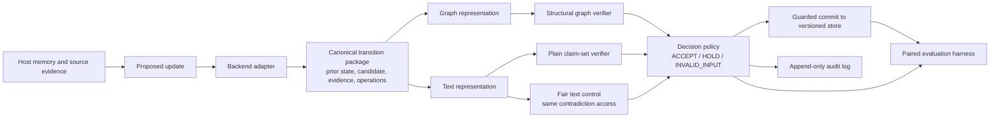

# CHAPTER 3 IMPLEMENTATION METHOD

*Draft v3 — 2026-11-08. Basis: commit `1ce84ce` for the rules-only run and fairness audit (243 passing tests in an isolated archive), code revision `4190526` for the held-out LLM run. Current `main` is later; the paper is pinned to the evaluated revision (see `paper/README.md`). Revision note: the opening of 3.1 now hands off to Chapters 1–2 instead of restating their background. Evaluation labels are single-reviewer exploratory annotations; second independent review pending. Citation keys refer to `paper/references.bib`; venue formatting is applied at submission.*

This chapter describes the implementation method of the study. Section 3.1 sets out the thinking framework that motivates the verification layer and the information-parity comparison. Section 3.2 describes the research methods: data collection, exploratory analysis of the frozen instrument, preprocessing, data splitting, the verifier configurations under comparison, and the evaluation procedure. Implementation facts are stated as facts about the artefact; observed outcomes are deferred to the results chapter.


## 3.1 Thinking Framework

Chapters 1 and 2 established the problem this study addresses and positioned it against existing memory systems and transition-verification work. The open question they leave is narrow: whether the representation used to verify a proposed memory update matters at all, once the information available to the verifier is held constant. Graph structures in memory systems are motivated mainly by organisation and retrieval, and in the present setting the only visible graph-versus-text difference is confined to a single annotation-access asymmetry. This section therefore does not restate the background. It states the framework that operationalises the representation question: the hypothesis under test, the decomposition that makes it testable, the artefact that instantiates it, and the mapping to the research questions.

The framework starts from the possibility that relational structure can expose update failures that are not apparent from the candidate records alone, but it refuses to assume that it does. The central hypothesis is that it can, and the central methodological requirement is that this hypothesis can only be tested when both representations receive **the same underlying facts**. If a graph verifier consumes an annotation — for instance evidence that explicitly contradicts a retained claim — while a text verifier does not, then any resulting difference measures *information access*, not representation. The framework therefore separates two questions that are easily conflated: whether contradiction or provenance information matters at all, and whether encoding the same information as graph structure adds anything beyond a flat representation of the same facts. The first is tested by comparing a plain text verifier with a fair text control that reads the same contradiction annotations; the second is tested by comparing that fair control with the structural graph verifier. This decomposition is the conceptual contribution of the study, and it is what allows a negative result to be informative rather than merely disappointing.

MemBud operationalises this framework as a verification layer that sits between a host memory system and its persistent write. A proposed update, together with the relevant prior records, source evidence, and declared operations, is converted by a backend adapter into a canonical transition package. The package is represented twice — as a canonical graph and as a deterministic text/JSON serialisation — and the same three criteria of coverage, preservation, and faithfulness [@yang2026trustmem] are applied in each representation. A decision policy maps the check outcomes to a commit decision, and only an accepted candidate is written to the guarded store; every outcome is recorded in an append-only audit log. Figure 3.1 summarises the framework.



*Figure 3.1. Thinking framework. The same canonical transition feeds both representations. The fair text control is not a production verifier but a methodological instrument that isolates information access from representation.*

Three considerations shape the rest of the design. First, safety is treated as a **pre-commit** property: verification is performed on the proposed transition, a failed or uncertain check results in a hold, and a schema-invalid transition is rejected before verification and never reaches storage. This is a deliberately conservative policy, and its cost — blocking legitimate updates — is measured rather than assumed away. Second, the representation is the **object of study, not a premise**: the canonical package is the single source of truth, both representations are generated from it, and no verifier receives information the other cannot obtain from the same package. Third, the evaluation is **evidence-first**: cases are frozen and hash-pinned before runs, the development and held-out splits are fixed together, every numerator and denominator is reported, and the analysis is descriptive at the available sample size. The design therefore can produce three kinds of outcome — a positive representation effect, no detectable effect, or a cost without benefit — and all three are treated as valid results.

The framework maps onto the three research questions stated in Chapter 1. RQ1 (reliability) is operationalised as paired conditions over identical cases plus the information-matched control described above, so that the reliability effect and the representation question are answered separately. RQ2 (modularity) is operationalised at the level of the adapter contract, a reference backend, and a documented feasibility inspection of two third-party systems; evaluation across three external backends remains future work. RQ3 (trade-offs) is operationalised as acceptance, false-hold, token and latency instrumentation; downstream question answering was not evaluated and is not inferred from acceptance decisions.

The scope of the framework is deliberately bounded. MemBud is a verification layer, not a memory system, and it is evaluated as a controlled artefact on synthetic transition cases rather than on production traffic. Third-party backend integration and downstream question-answering utility are architectural ambitions that motivate the design but are not claimed as evaluated contributions in this study. Within that boundary, the framework makes a specific and testable proposition: that a fair comparison between graph and text verification, together with a transparent account of what each representation can see, yields more defensible knowledge about memory-transition safety than a comparison that confounds representation with information access. The remaining sections describe the data, the preprocessing, the models, and the evaluation procedure that instantiate this framework.

## 3.2 Research Methods

This chapter adopts a design-science approach in which a software artefact is specified, implemented, and then evaluated under controlled conditions. The study is not a field survey, a user study, or a population-level benchmark: it constructs a verification layer, freezes a purpose-built evaluation instrument, and compares several verification strategies on exactly the same transition cases. The evaluation is quantitative and paired, but it is descriptive rather than inferential, because the available instrument is small and annotated by a single reviewer. The methodological contribution is therefore not a performance estimate for memory verification in general; it is the demonstration of how a representation-level hypothesis can be tested fairly, together with the artefact that makes such a test possible.

**Artefact scope.** The implemented system comprises a canonical transition schema (version 2) with strict operation-coverage invariants and structured deletion authorisation; a structural graph verifier and an independent exact-claim-set text verifier; a fair text control that consumes the same contradiction annotations as the graph verifier; a separate, opt-in semantic comparator that fails closed to uncertainty; a versioned, lock-protected store whose state changes only on acceptance; a reference backend adapter (in-memory and SQLite) with interposed guarded writes; and an evaluation harness with hash-pinned manifests, explicit-denominator metrics, and append-only audit records. Two third-party memory systems were inspected for a safe pre-commit boundary, but neither was integrated at the evaluated revision; the adapter contract and the reference backend are the implemented artefacts, and evaluation across external backends remains future work. Likewise, the study does not measure downstream question-answering utility, although the design anticipates it. These boundaries are stated here because they determine which research questions the method can answer.

**Unit of analysis.** The primary unit is a *transition case*: one frozen package containing the prior memory state, the source evidence available for the update, the required claims, the proposed candidate state, and the declared operations. Cases, rather than claims or records, are paired across conditions. Claim- and record-level quantities are used to characterise how much is at stake in a case, but their denominators are reported separately and they are not treated as independent samples. This choice matters for the analysis: with 36 cases, a claim-level test would give a misleading impression of statistical power that the design does not have.

**Procedure.** The study proceeds in six stages. First, the artefact is specified and implemented against a test suite, with the deterministic verifiers as the default and model-based verification as an explicitly selected option. Second, the evaluation instrument is assembled: 36 synthetic transition cases covering valid updates, omission, corruption, unsupported additions, unsupported provenance, unresolved contradiction, and intentionally invalid input are authored under a written annotation protocol, labelled separately from the verifier inputs, and frozen in a hash-pinned manifest with a fixed 18/18 development/held-out split. Third, a deterministic rules-only run executes the unguarded, plain text, and graph strategies on all cases, and a separate deterministic fairness audit adds the fair text control; neither run makes paid model calls. Fourth, an information-parity audit compares the plain text, fair text, and graph strategies in a paired fashion, so that the effect of annotation access and the effect of representation are separated. Fifth, a capped held-out run evaluates graph, text, and semantic conditions with a pinned language model on the held-out split, under an explicit token budget and with no tuning on the observed outcomes. Sixth, the results are analysed by split and pooled, with explicit numerators and denominators, and interpreted against the design's stated limits.

**Conditions.** All conditions receive the same frozen case package, the same candidate update, and the same decision policy; only the verifier and its representation differ. Table 3.1 summarises the conditions and what distinguishes them. The plain text condition is the historical non-graph control; the fair text condition is the information-matched control; the graph condition is the representation under test. The information-parity logic is explicit in the table: the comparison between plain text and fair text isolates the value of contradiction information, while the comparison between fair text and graph isolates the value of representing the same information as structure. Model-based conditions reuse one pinned model, prompt policy, temperature, and response-validation procedure for both representations, so that representation is the only intended difference.

*Table 3.1. Verification conditions and what differs between them.*

| Condition | Verifier | Representation | Reads explicit contradiction annotations | Role in the design |
|---|---|---|---|---|
| Unguarded | none (candidate applied) | — | — | reference for the raw effect of the proposed update |
| Plain text | exact claim-set checks | deterministic text/JSON | no | historical non-graph baseline |
| Fair text | claim-set checks plus contradiction access | deterministic text/JSON | yes | information-matched control |
| Graph | structural graph verification | canonical graph | yes | representation under test |
| Text–LLM | model-based verifier | text serialisation | yes (same canonical facts) | model-based representation comparison |
| Graph–LLM | model-based verifier | graph serialisation | yes (same canonical facts) | model-based representation comparison |
| Semantic | deterministic text plus semantic comparator | text plus comparator | no | optional semantic check, fail-safe on uncertainty |

**Data and instrument.** The instrument is a frozen set of 36 synthetic transition cases, split 18/18 into development and held-out cases, with 7 valid, 6 faulty, and 5 intentionally invalid cases per split. Inputs and labels are stored in separate hash-pinned files; the manifest records the case-file and label-file digests, the expected decision distribution, and the review status. Labels are single-reviewer exploratory annotations: the cases and the proposed decisions were authored by the same reviewer during development, a blind second-review workflow exists, but it has not been executed and no inter-annotator agreement statistic exists. The instrument is therefore described as exploratory throughout, and no result is presented as independently annotated ground truth. Section 3.2.1 details collection and annotation, Section 3.2.2 characterises the frozen instrument descriptively, Section 3.2.3 describes preprocessing, and Section 3.2.4 describes the split.

**Analysis.** Section 3.2.6 fixes the metrics and denominators before any result is reported: candidate error rates at claim and record level, decision counts, faulty-detection precision and recall, false accepts, false holds, valid-update acceptance, and paired case-level differences between conditions. It also fixes the inference policy. Because the instrument has 36 single-reviewed synthetic cases, the analysis reports exact counts, paired differences, and per-split breakdowns, and it makes no significance or power claims; bootstrap confidence intervals over cases are specified as the analysis to apply to a larger, independently reviewed set. Cost and latency instrumentation is separated into preparation, verification, and end-to-end time, and the monetary cost of paid runs is reported as unavailable where the provider does not expose billed cost. The same section records the threats to validity — construct, internal, external, and statistical-conclusion — and the ethical constraints under which the study was conducted.

**Reproducibility.** Every run is identified by a run ID, a code revision, and a manifest digest, and writes append-only audit records rather than overwriting earlier artefacts. Deterministic runs are reproducible without any paid calls; the one model-based run pins the model identifier, prompt versions, temperature, output schema, retry policy, and token cap, and caches validated responses so that re-analysis does not require repeat spending. The implementation is covered by a test suite of 243 passing tests at commit `1ce84ce`, the evaluated revision. The evaluation artefacts are committed alongside the code: case and label files, manifests, run summaries, metrics, fairness-audit output, and the held-out run's summary and metrics.

**Claims boundary.** The method supports statements about the behaviour of the implemented artefact, about the fairness of the comparison protocol, and about what is and is not detectable with the frozen instrument. It does not support statements about production reliability, third-party backend compatibility, downstream question-answering utility, or the general superiority of graph over text verification. That boundary is not a disclaimer appended to the method; it is a consequence of the design, and the evaluation section states how each claim is bounded by the available evidence.

### 3.2.1 Data Collection

The evaluation instrument is a purpose-built synthetic set of 36 transition cases, stored as `membud-evaluation-v2` under `data/`. It was assembled specifically for this study rather than sampled from an existing memory benchmark. Three requirements motivated the choice. First, the design needs cases whose ground truth is known by construction: for each case the experiment must know whether the candidate update is valid, which prior records must survive, and whether the input is deliberately malformed. Second, the cases must be publishable without licensing constraints. Third, the verifier consumes per-claim fields — required claims, material candidate claims, explicit operation declarations, and structured deletion authorisation — that public memory benchmarks do not supply at the granularity the method requires.

Two public resources were assessed and deliberately not used. HaluMem [@chen2026halumem] provides dialogues, reference memory points, and an update-level evaluation; it is released under CC BY-NC-ND 4.0, so neither the dataset nor adapted cases may be committed or redistributed here. More importantly, HaluMem does not provide the per-claim `required_claims`, the material-claim annotations, the structured operation authorisation, or the corruption labels for unrelated prior records that MemBud's transition package uses; its update categories are assigned by a prompt rather than by independent human annotation. LoCoMo [@maharana2024locomo] evaluates very long-term conversational retention, which is a different question from whether a single proposed transition should be committed, and it is reported to be released under CC BY-NC-SA. Adapting either resource would require a separate annotation protocol, a documented field mapping, and licence review, so no licensed data, derived record, or quoted passage appears in this study. The cost of this decision is external validity: the instrument is not a sample of production memory traffic and its results are not population estimates.

Each line of `data/cases/evaluation-v2.jsonl` is one transition package under `schema_version: 2`. The package contains a `before` list of prior records, each with a stable identifier and a list of atomic claims; a `candidate` list proposing the post-update state; an `evidence` list in which each item carries an identifier, a source label, text, and the claims it `supports` and, where applicable, `contradicts`; a `required_claims` list that is a verifier input rather than an outcome; and an `operations` list declaring `WRITE`, `REVISE`, `DELETE`, `SUPERSEDE`, or `NOOP`. A `DELETE` must carry a structured `authorization` object with source, evidence identifier, target identifier, and rationale; free-text reasoning alone is not authorisation. The package is deliberately redundant enough to be checkable: the declared operations must account for every actual difference between `before` and `candidate`, because undeclared state changes are rejected by the schema before verification. Expected decisions, case categories, expected-persistence annotations, and corrupted-record identifiers live in the separate labels file `data/labels/evaluation-v2.jsonl`, so that verifier inputs never contain the answer. The candidate updates were hand-authored once and frozen; the manifest records that they are reused unchanged across every condition, so that representation and verifier construction are the only differences between the compared strategies.

The set covers 18 categories with two cases each. Seven categories exercise updates that should be accepted: `valid_write`, `valid_revise`, `valid_supersede`, `valid_delete_authorized`, `valid_noop`, `valid_multi_op`, and `valid_contradiction_correction`, for 14 cases. Six categories exercise faulty proposals that a safe verifier should not commit: `omission`, `corruption_no_evidence`, `corruption_insufficient_evidence`, `unsupported_addition`, `unsupported_provenance`, and `contradiction_unresolved`, for 12 cases. Five families exercise invalid input that must be rejected before verification: `invalid_unauthorized_delete`, `invalid_delete_authorization_target`, `invalid_undeclared_insertion`, `invalid_undeclared_modification`, and `invalid_undeclared_removal`, for 10 cases. Table 3.2 summarises the composition; Section 3.2.2 characterises it numerically, and Section 3.2.4 describes how the categories are balanced across the development and held-out splits.

*Table 3.2. Composition of the frozen 36-case evaluation instrument.*

| Group | Categories | Cases |
|---|---|---:|
| Valid updates (expected ACCEPT) | `valid_write`, `valid_revise`, `valid_supersede`, `valid_delete_authorized`, `valid_noop`, `valid_multi_op`, `valid_contradiction_correction` | 14 |
| Faulty proposals (expected HOLD) | `omission`, `corruption_no_evidence`, `corruption_insufficient_evidence`, `unsupported_addition`, `unsupported_provenance`, `contradiction_unresolved` | 12 |
| Invalid input (expected INVALID_INPUT) | `invalid_unauthorized_delete`, `invalid_delete_authorization_target`, `invalid_undeclared_insertion`, `invalid_undeclared_modification`, `invalid_undeclared_removal` | 10 |

Annotation followed the written rules in `data/annotation-guidelines.md`. Records are decomposed into atomic claims without adding facts or altering qualifiers, time, uncertainty, or attribution. A claim is treated as material when changing, omitting, or adding it could alter the record's meaning, identity, temporal status, or the decision to accept the update. `required_claims` are derived from in-scope claims designated before any verification result is seen, plus prior claims that the persistence policy requires to survive absent supported correction, supersession, or authorised deletion. Each prior record is annotated as valid or invalid and as expected to persist, and only valid records expected to persist enter the corruption denominator. Each material candidate claim is annotated as supported by the supplied evidence, supported by valid prior memory, unsupported, contradicted, or uncertain. Operations and deletion authorisation are annotated independently of the expected decision, and the expected outcome is assigned only after the factual annotations are complete. The three evaluation dimensions used by the verifiers — coverage, preservation, and faithfulness — follow the memory-transition verifier framing of TrustMem [@yang2026trustmem]; this study adopts the criteria and does not claim them as novel.

All 36 labels carry `label_status: single_reviewer_second_review_pending`. The cases and their proposed labels were authored by one reviewer, the project owner, during milestone development. A second independent human review has not been performed: the blind quiz `data/review/quiz-v2.html` is built and contains the 36 transition inputs with no labels, in hash order so that ordering cannot hint at the expected decision, and `scripts/review_quiz.py --grade` is prepared to compare a reviewer's answers with the frozen labels; `data/review/adjudication-template.md` defines the adjudication record. No reviewer has filled in the quiz and no inter-annotator agreement statistic exists. The labels must therefore be read as single-reviewer exploratory annotations, and they are never described in this study as double-annotated, independently reviewed, adjudicated, or gold data. This limitation is stated wherever the instrument is used, because it bounds every result that depends on the labels.

The instrument is frozen by hash. `data/manifests/evaluation-v2.json` records the manifest identifier `membud-evaluation-v2`, `schema_version: 2`, `status: frozen_exploratory_single_reviewer_second_review_pending`, `case_count: 36`, `split_counts: {dev: 18, heldout: 18}`, the expected decision distribution `{ACCEPT: 14, HOLD: 12, INVALID_INPUT: 10}`, the cases SHA-256 `40558746e915c6f5296235109900c050da61f87fe4f4fe320bf0290af9aa432d`, the labels SHA-256 `9280d3e8e2aa7a61df31bed689647f768a98361bb7509e7f8d172bb376989a14`, and the split and expected-invalid flag for every case identifier. The analysis layer recomputes both file digests and refuses to produce metrics if either digest disagrees with the manifest, and the evaluation runner refuses to start if a case's actual schema validation disagrees with its `expected_invalid` flag. Any change to a case, a label, or the manifest therefore requires a new frozen version; the frozen files in this study are the ones whose SHA-256 values are recorded above. The manifest itself hashes to `e1adf173a3f84d4f8d4ca910bdcabb2e6dd69a0f64be4509395090f5507d527a`, which is the digest recorded with the rules-only metrics.

### 3.2.2 Exploratory Data Analysis

This subsection characterises the frozen instrument before any outcome is reported. Its purpose is descriptive rather than inferential or evaluative: it establishes what the 36 cases contain, whether the intended balance was achieved, and how large the claim- and record-level denominators are, so that the metric definitions in Section 3.2.6 can be read against a known instrument. The analysis inspects only the two frozen input files and the manifest; it does not read condition outputs, decisions, or audit logs, and therefore produces no finding about any verifier. Because the numbers below are computed, the exact command producing them is recorded here; it was run from the repository root.

```
cd /home/ifan/Projects/MemBud && .venv/bin/python - <<'PY'
import json, collections as C, statistics as S, hashlib
from pathlib import Path
rd=lambda p:[json.loads(x) for x in Path(p).read_text(encoding='utf-8').splitlines() if x.strip()]
cases,labels=rd('data/cases/evaluation-v2.jsonl'),rd('data/labels/evaluation-v2.jsonl')
man=json.loads(Path('data/manifests/evaluation-v2.json').read_text(encoding='utf-8'))
lab={l['case_id']:l for l in labels}
sha=lambda p:hashlib.sha256(Path(p).read_bytes()).hexdigest()
a=lambda v:f"total={sum(v)} mean={round(S.fmean(v),4)} min={min(v)} max={max(v)}"
print('sha_match',sha('data/cases/evaluation-v2.jsonl')==man['cases_sha256'],sha('data/labels/evaluation-v2.jsonl')==man['labels_sha256'])
print('manifest_sha256',sha('data/manifests/evaluation-v2.json'))
print('cases',len(cases),'labels',len(labels))
print('split',dict(C.Counter(l['split'] for l in labels)))
print('decision',dict(C.Counter(l['expected_decision'] for l in labels)))
print('decision_dev',dict(C.Counter(l['expected_decision'] for l in labels if l['split']=='dev')))
print('decision_heldout',dict(C.Counter(l['expected_decision'] for l in labels if l['split']=='heldout')))
print('categories',dict(sorted(C.Counter(l['category'] for l in labels).items())))
print('label_status',dict(C.Counter(l['label_status'] for l in labels)))
per=[dict(before_records=len(c['before']),candidate_records=len(c['candidate']),
 before_claims=sum(len(r['claims']) for r in c['before']),candidate_claims=sum(len(r['claims']) for r in c['candidate']),
 evidence_items=len(c['evidence']),supports=sum(len(e.get('supports',[])) for e in c['evidence']),
 contradicts=sum(len(e.get('contradicts',[])) for e in c['evidence']),
 required_claims=len(c['required_claims']),operations=len(c['operations'])) for c in cases]
[print(f,a([r[f] for r in per])) for f in per[0]]
print('contradiction_cases',sum(r['contradicts']>0 for r in per),'no_evidence_cases',sum(r['evidence_items']==0 for r in per))
print('operation_types',dict(C.Counter(o['type'] for c in cases for o in c['operations'])))
print('invalid_families',dict(C.Counter(l['category'] for l in labels if l['expected_decision']=='INVALID_INPUT')))
def er(ids):
 om=req=un=cand=cor=vp=0
 for c in cases:
  if c['case_id'] not in ids: continue
  l=lab[c['case_id']]; b={x for r in c['before'] for x in r['claims']}
  cc={x for r in c['candidate'] for x in r['claims']}; ev={x for e in c['evidence'] for x in e.get('supports',[])}
  rq=set(c['required_claims']); om+=len(rq-cc); req+=len(rq); un+=len(cc-b-ev); cand+=len(cc)
  vp+=len(l['valid_prior_records_expected_to_persist']); cor+=len(l['corrupted_prior_record_ids'])
 return f'omission={om}/{req} unsupported={un}/{cand} corruption={cor}/{vp}'
allids={c['case_id'] for c in cases}
print('error_slots_pooled',er(allids))
print('error_slots_dev',er({c['case_id'] for c in cases if lab[c['case_id']]['split']=='dev'}))
print('error_slots_heldout',er({c['case_id'] for c in cases if lab[c['case_id']]['split']=='heldout'}))
PY
```

The command verifies that both files still match the manifest's SHA-256 pins, then reports composition, per-split label distribution, per-category counts, structural counts, operation types, invalid-input families, and the denominators. Its output is the source of every number below.

The set contains 36 cases, split evenly into 18 development and 18 held-out cases. The expected decisions are 14 `ACCEPT`, 12 `HOLD`, and 10 `INVALID_INPUT` pooled, and the two halves are exactly balanced at 7 `ACCEPT`, 6 `HOLD`, and 5 `INVALID_INPUT` each. All 36 labels carry `single_reviewer_second_review_pending`. Every one of the 18 categories contains exactly two cases, one development and one held-out case: the output's `categories` counter (and the `case_category_counts` field in the metrics artefact) has value 2 for all 18 keys, so the set contains seven valid-update categories (14 cases), six faulty-proposal categories (12 cases), and five invalid-input families (10 cases), as described in Section 3.2.1.

The cases are small by design. Table 3.3 reports each structural count over the 36 packages. A case contains one to three prior records and prior claims; its candidate state contains zero to three records and zero to four claims; it supplies zero to three evidence items, zero to three `supports` annotations, and at most one `contradicts` annotation; it lists one to three required claims; and it declares zero to three operations. The totals matter for denominators: there are 68 required-claim slots, 64 candidate-claim slots, and 40 prior-record slots annotated as expected to persist.

*Table 3.3. Structural counts per case package (n = 36).*

| Quantity | Total | Mean per case | Min | Max |
|---|---:|---:|---:|---:|
| Prior records | 57 | 1.5833 | 1 | 3 |
| Candidate records | 62 | 1.7222 | 0 | 3 |
| Prior claims | 57 | 1.5833 | 1 | 3 |
| Candidate claims | 64 | 1.7778 | 0 | 4 |
| Evidence items | 36 | 1.0000 | 0 | 3 |
| `supports` annotations | 34 | 0.9444 | 0 | 3 |
| `contradicts` annotations | 4 | 0.1111 | 0 | 1 |
| Required claims | 68 | 1.8889 | 1 | 3 |
| Declared operations | 36 | 1.0000 | 0 | 3 |

The zero minima are structural rather than accidental. Four cases supply no evidence — both `valid_noop` and both `corruption_no_evidence` cases — which tests that absent evidence is not permission to change memory. Four cases carry contradiction annotations: the two `contradiction_unresolved` and two `valid_contradiction_correction` cases. The four `invalid_undeclared_insertion` and `invalid_undeclared_modification` cases declare no operation, which is the violation they test, and the two `invalid_unauthorized_delete` cases have an empty candidate because the whole prior state is proposed for removal without authorisation. The declared operations sum to 36: 11 `WRITE`, 11 `REVISE`, 6 `DELETE`, 6 `NOOP`, and 2 `SUPERSEDE`; the two `valid_multi_op` cases each declare three operations.

The five invalid-input families each contribute two cases, one per split: a `DELETE` without structured authorisation; an authorisation whose evidence or target reference does not resolve; an undeclared insertion; an undeclared modification; and an undeclared removal. Every one is expected to fail schema construction before verification, so none should produce an `ACCEPT` or `HOLD` decision or write memory; the labels flag all ten with `expected_invalid: true`, and the manifest records the same flag.

Finally, the candidate-error denominators were derived directly from the frozen cases and labels. Table 3.4 reports them pooled and per split. The pooled values agree exactly with the `candidate_error_rates` object in `data/results/evaluation-v2/metrics.json`, an independent implementation of the same definitions; that agreement supports reporting these rates with explicit numerators and denominators.

*Table 3.4. Claim and record slots used as candidate-error denominators.*

| Metric | Dev | Held-out | Pooled |
|---|---:|---:|---:|
| Omission (required claims absent / required claims) | 6 / 33 | 6 / 35 | 12 / 68 |
| Unsupported addition (unsupported candidate claims / candidate claims) | 4 / 31 | 4 / 33 | 8 / 64 |
| Prior-record corruption (corrupted persistent records / persistent prior records) | 2 / 19 | 2 / 21 | 4 / 40 |

Two points matter. First, the numerators are properties of the frozen proposals, not of any verifier: the instrument contains a fixed number of missing required claims, unsupported candidate claims, and corrupted prior records, and the candidate-error metrics measure whether the instrument encodes the intended fault, not whether a verifier detected it. Second, the three denominators differ from the case count and from each other, so no single case-level percentage can represent all three rates. Section 3.2.6 therefore keeps claim-slot, record-slot, and case-level denominators separate and reports a rate as not applicable, never as zero, when its denominator is empty.

### 3.2.3 Data Preprocessing

Preprocessing converts the authored evaluation cases into a canonical, verifier-ready form and fixes the provenance of the artefacts consumed later. It performs no feature engineering: claims, evidence, required claims, and operations are preserved as authored, with no text normalisation, paraphrase, or inference. Its responsibilities are canonicalisation into transition schema version 2 and integrity control over inputs and labels, so that every verifier receives the same facts.

Each evaluation case is one JSON object in a JSONL case file (`data/cases/evaluation-v2.jsonl`), carrying a `case_id`, an explicit `schema_version` of 2, the complete prior state (`before`), the complete proposed state (`candidate`), the evidence available for the update (`evidence`), the claims required to survive (`required_claims`), and the declared operations (`operations`). States are given in full rather than as deltas. Records carry stable string identifiers (`r1`, `r2`, …) and a list of claim strings; evidence items carry identifiers (`e1`, …), an optional `source`, an optional `text` excerpt, a `supports` list, and an optional `contradicts` list. The separate label file holds split, category, expected decision, invalid-input flag, fault types, persistence annotations, and review status, and contains no verifier input. Candidate states were hand-authored once and reused unchanged.

A single constructor, `Transition.from_dict`, normalises the input into the canonical data structures and validates it before any verifier sees it. Version handling is explicit: input that omits `schema_version` is treated as frozen version-1 archival data under the weaker legacy operation semantics, whereas every case here declares version 2 and is subject to the strict invariants below. Legacy `supersedes` notation is accepted only during loading and normalised into explicit operations; serialised output uses `operations` exclusively. Record and evidence identifiers must be non-empty and unique, claim strings non-empty, and every evidence reference used by an operation must resolve. Claims carry no separate identifier: claim identity is the exact claim string, from which the canonical graph later derives claim-node identifiers, consistent with the exact-string semantics of the deterministic checks.

Schema version 2 makes the declared operations the only authority for state change. Every added candidate record must be declared by `WRITE` or `SUPERSEDE`; every changed prior record by a `REVISE` that actually changes it; every removed prior record by `DELETE` or `SUPERSEDE`; and every declared operation must correspond to a real state change. A prior record may be targeted, and a candidate record proposed, by only one operation. `NOOP` must be the sole operation and its candidate state must equal the prior state; `WRITE` must reference a new candidate record, `REVISE` must retain the targeted identifier, and `SUPERSEDE` must introduce a distinct replacement while removing the target. A `DELETE` additionally requires a non-empty reason and structured authorisation `{source, evidence_id, target_id, rationale}`, with `evidence_id` referencing evidence in the same transition and `target_id` matching the operation target, so a free-text reason alone cannot authorise removal. Undeclared insertions, modifications, or removals raise a validation error at construction and are classified as `INVALID_INPUT` before verification.

An evidence item may declare `contradicts`, a list of claim strings it contradicts. The annotation is a verifier input, not a label, and the only mechanism by which a contradiction can be expressed in the canonical transition. It contributes claim nodes and `CONTRADICTS` edges to the graph and is consumed by the structural graph verifier; the plain exact-claim-set text baseline deliberately does not read it, while the fair text control introduced in Section 3.2.5 does. Comparing a verifier that reads this annotation with one that does not therefore measures information access rather than representation.

Inputs and labels are stored in separate hash-pinned JSONL files and loaded by separate functions; the manifest digests and the review status are described in Section 3.2.1. Loaders verify both digests before use and abort on a mismatch; a case whose actual schema validation disagrees with its manifest `expected_invalid` flag stops the run as a data-integrity error rather than becoming a scored outcome. Labels are used only for reporting and metrics and never appear in verifier inputs, graph structures, or model prompts. Inputs and labels were frozen before any version-2 run, with no held-out tuning; the labels remain single-reviewer exploratory annotations with a second independent review pending, so they support an exploratory paired analysis rather than an adjudicated gold standard.

Both representations are derived deterministically from the same validated transition. The canonical dictionary form contains `schema_version`, `case_id`, `before`, `candidate`, `evidence`, `required_claims`, and `operations`; the text representation is compact JSON with sorted keys and preserved UTF-8 characters, so repeated serialisation is byte-identical. The canonical graph is built from that transition alone: transition, before and candidate record, claim, evidence, and operation nodes, connected by `BEFORE`, `PROPOSES`, `CONTAINS`, `HAS_EVIDENCE`, `SUPPORTS`, `REQUIRES`, `HAS_OPERATION`, `REVISES`/`DELETES`/`SUPERSEDES`, `CONTRADICTS`, and `AUTHORIZED_BY` edges. Because the graph re-encodes the same facts and introduces no new inputs, a decision difference between the graph and fair-text verifiers is attributable to verifier construction rather than to preprocessing.

For the optional language-model verifier, the graph is rendered as sorted-key JSON of its node and edge dictionaries and the text representation as the JSON described above. Both enter an identical system prompt and user-message template, differing only in representation label and serialised content, and the request is issued in JSON mode at temperature zero. Labels never enter a prompt, and the prompt version is recorded with each result. Rendering belongs to preprocessing because it fixes what the model may see.

The frozen instrument contains 36 synthetic transitions, 10 of them intentionally invalid and exercising the rejection path across five families (two cases each): unauthorised deletion, mismatched deletion authorisation, and undeclared insertion, modification, and removal. These are recorded as `INVALID_INPUT` construction failures rather than verifier detections and never write memory. All cases are synthetic, Indonesian-themed, and project-authored. Two external resources were considered but not used: HaluMem, whose dataset card declares CC BY-NC-ND 4.0 and which does not supply the per-claim transition labels this instrument requires [@chen2026halumem], and the LoCoMo benchmark [@maharana2024locomo]. No licensed data enters the pipeline or the instrument.

### 3.2.4 Data Splitting

The frozen instrument is partitioned into two halves of 18 cases each: 18 development cases (`DEV-01` to `DEV-18`) and 18 held-out cases (`HELD-01` to `HELD-18`). The split is not a train/test split in the machine-learning sense, because no model is trained on either half. It is an outcome-blind partition that separates the cases available during development from the cases reserved for reporting, and it is recorded twice: in `data/manifests/evaluation-v2.json` through `case_entries[].split` and `split_counts: {dev: 18, heldout: 18}`, and in `data/labels/evaluation-v2.jsonl` through each case's `split` field. Both files are SHA-256 pinned, so the partition cannot drift between runs without a hash mismatch.

The two halves were authored together and frozen before any v2 run. This sequencing matters more than the arithmetic of the split: because the development and held-out cases were constructed as one instrument and labelled in the same pass, a case cannot have entered one half after a result was seen. The manifest's `notes` record this explicitly, and the evaluation protocol states that the 18 development and 18 held-out cases were authored together and frozen before the rules-only comparison was executed. Any later change to a case, a label, or the manifest would require a new manifest version and a restart of the review process.

The halves are balanced on the properties the evaluation depends on. Each split contains 7 cases labelled `ACCEPT`, 6 labelled `HOLD`, and 5 labelled `INVALID_INPUT`, as Table 3.5 shows. Each of the 18 categories contributes exactly one development and one held-out case, so the valid-update, faulty-proposal, and invalid-input groups are represented in identical proportions in both halves. The balance is therefore structural rather than a coincidental result of sampling: it follows from the construction rule rather than from an assignment procedure applied after the cases existed. This is why per-split and pooled analyses are comparable without weighting.

*Table 3.5. Decision-label balance across the frozen split.*

| Labels | Development | Held-out | Pooled |
|---|---:|---:|---:|
| `ACCEPT` | 7 | 7 | 14 |
| `HOLD` | 6 | 6 | 12 |
| `INVALID_INPUT` | 5 | 5 | 10 |
| Cases | 18 | 18 | 36 |

The development half served the work that must precede a reported evaluation: checking schema construction, exercising the runners and stores, debugging case packages, and refining the annotation and metric definitions. Those activities touched code and protocol, not held-out outcomes. The held-out half was reserved for the reported runs. The rules-only comparison reports both splits separately and pooled, so a reader can see whether the instrument behaves consistently across halves; the capped held-out language-model and semantic run was executed once, on the held-out split only, under the token cap described in Section 3.2.5. No prompt, threshold, case selection, or metric definition was chosen by inspecting held-out outcomes, and no case was moved between halves after any result was produced. The split was frozen before the first v2 run and remains unchanged.

The rationale for splitting at all is internal validity, and the rationale for its size is honesty about power. Freezing a held-out half before the reported runs gives a check against inadvertent tuning: if every case used for reporting had also been available while the instrument was being refined, a reader could not distinguish a property of the verifier from a property of the construction process. Reserving half the cases makes that contamination visible rather than assumed away. The cost is statistical: with 18 cases per split, and 7 valid, 6 faulty, and 5 invalid cases within each, a per-split contrast can only detect large differences, and no per-split significance or power claim is warranted. The split is reported to support descriptive comparison and replication, not to license subgroup inference, and the pooled 36-case analysis in Section 3.2.6 carries the same descriptive limitation. Splitting also does not create independence: the halves are neither independently authored nor independently reviewed, and the held-out labels are single-reviewer exploratory annotations just like the development labels.

### 3.2.5 Modelling

In this study, "modelling" does not mean fitting a statistical or machine-learning model. No model is trained or fine-tuned; the optional language model is used only as a verifier. What the section specifies is the set of verifier configurations whose decisions are compared, the decision policy that maps their outputs to a commit or a hold, the storage and adapter boundary that enforces those decisions, and the run modes that produce the evaluation artefacts. Every condition receives the same frozen case package: the same prior state, evidence, required claims, declared operations, and fixed candidate state. Only the verifier and, where stated, the representation differ. The unit of analysis remains the transition case, and cases are compared in pairs; conditions are not independent samples.

**Unguarded condition.** The first configuration is a negative gate rather than a verifier: the schema-valid candidate is applied unconditionally, with no checks and no decision model. In the three-condition rules-only run this is recorded as `APPLIED` rather than as a verifier decision, with schema-invalid cases still recorded as `INVALID_INPUT`; in the four-strategy fairness audit the same behaviour is recorded as `ACCEPT` so that all strategies share one decision vocabulary. The condition measures the raw effect of the candidate update and provides the reference against which any safety gate is described. It cannot be interpreted as evidence that a guarded condition is useful, because it deliberately performs no verification.

**Exact-claim-set text baseline.** The second configuration is the historical non-graph control. It compares exact claim sets over the canonical transition and evaluates three criteria: coverage, preservation, and faithfulness. Coverage requires every claim in `required_claims` to appear in the candidate state. Preservation requires the claims of each prior record to remain a subset of the corresponding candidate record's claims unless the transition declares an operation for that record; a changed record is accepted when the added claims are backed by evidence, and a `DELETE` is accepted only through its structured authorisation. Faithfulness requires every candidate claim to appear in the prior state or in the evidence's `supports` lists. Claims are compared as exact strings: the baseline does not infer paraphrase, semantic equivalence, or contradiction, and it deliberately does not read the `evidence.contradicts` field. It is implemented independently of the graph verifier so that a difference between the two reflects different verification mechanisms rather than shared code. The three criteria are adopted from prior transition-verification work [@yang2026trustmem]; they are not claimed as a contribution of this study.

**Information-parity control.** The third configuration, `text_fair`, is the exact-claim-set baseline plus the same contradiction information the structural graph verifier consumes. If any candidate claim appears in an evidence item's `contradicts` list, the faithfulness check fails with reason code `CONTRADICTED_CLAIM`; otherwise the baseline result is returned unchanged. The control is a deliberately minimal, independent text-side implementation and does not import or call the graph verifier, and it is used in the fairness audit rather than in the production dispatch. Its role is methodological: comparing the plain text baseline with the graph verifier without such a control mixes two things, namely which annotations a verifier is allowed to read and how it constructs its decision from them. The contrast from plain text to the fair control therefore isolates contradiction information access, while the contrast from the fair control to the graph verifier isolates verifier construction with information held equal. Only the second contrast can support a representation-level claim, and the analysis in Chapter 4 is organised around that decomposition. The control is also the reason the study does not compare the plain baseline with the graph verifier directly and call the difference a graph effect.

**Structural graph verifier.** The fourth configuration builds the canonical graph described in Section 3.2.3 and derives its decision from graph adjacency rather than from claim sets. Coverage is evaluated by required-claim reachability: every `required_claims` item must be attached to the transition node by a `REQUIRES` edge and contained by a candidate record. Provenance is evaluated by paths: a candidate claim that is absent from prior memory needs a `SUPPORTS` edge from an evidence node connected to the transition. Preservation and removal are evaluated through operation edges: a prior record must either remain a claim superset of its candidate counterpart or be reached by a `REVISES`, `DELETES`, or `SUPERSEDES` edge from an operation node, and a changed record needs evidence-backed additions reachable through provenance edges. Contradiction is evaluated through `CONTRADICTS` edges: a `CONTRADICTS` edge from connected evidence to a claim present in the candidate state causes a faithfulness failure. Connectivity is evaluated from the transition: claim nodes unreachable from the transition node are rejected as disconnected. Finally, structural consistency is evaluated against the expected node and edge set: dangling edges, duplicate nodes, missing or unexpected nodes, unattached required claims, and operation or authorisation edges that do not match the declared operations are rejected with `GRAPH_STRUCTURE_INVALID`. Each failed check carries a machine-readable reason code and the affected claim or record identifiers. The structural checks are not claimed to outperform an information-matched text control; their design value is defence against malformed or injected graph inputs that a canonical text transition cannot express, together with attribution of a failure through reason codes and affected identifiers. Any decision-level difference between the two is an empirical question reported descriptively in Chapter 4, where a zero difference is read as no detectable advantage at this sample size rather than as equivalence.

**Optional language-model verifier.** The fifth configuration replaces the deterministic checks with a language model that receives the same canonical facts and returns the same three checks. It is optional and feature-gated: no provider call occurs unless the LLM path is explicitly selected. Both representations use the same prompt version, `membud-transition-checks-v1`, the same system prompt, the same user-message template, the same output schema, and the same retry policy; only the serialised representation differs. The graph is rendered as sorted-key JSON of its node and edge dictionaries and the text input as sorted-key JSON of the canonical transition. Requests use the provider catalog model ID `deepseek-flash` at temperature zero and JSON mode (an explicit JSON response format). The response is validated strictly: exactly three check objects, exactly the permitted fields, one of the permitted statuses, a reason code from the allowed set for that check and status, a non-empty reason, and a string list of affected identifiers. Transport failures, malformed JSON, and schema violations are bounded by a small number of provider attempts and at most one JSON-repair retry; if a valid response is still unavailable, all three checks become `UNCERTAIN` with `INVALID_VERIFIER_OUTPUT`, and the decision is `HOLD`. The model is identified in the artefacts by the provider catalog ID and the API-returned model string; the comparison does not assert an immutable provider-side revision behind that identifier. The two model-based representations differ in input length and therefore in token and latency budget, so graph-versus-text model conditions are not an equal-budget comparison and are reported descriptively rather than as a performance comparison.

**Optional semantic comparator.** A separate, opt-in semantic mechanism compares claim strings for paraphrase and contradiction. Its comparator returns one of `EQUIVALENT`, `CONTRADICTORY`, `UNRELATED`, or `UNCERTAIN`, using the prompt version `membud-semantic-compare-v1`, strict JSON validation, and a fail-safe rule: any transport failure, malformed response, or validator rejection becomes `UNCERTAIN` and never raises. Candidate claims that are unsupported by the exact baseline are compared against prior and evidence claims, and candidate claims are also compared pairwise. The aggregation is fail-closed, with `CONTRADICTORY` outranking `EQUIVALENT`, which outranks `UNCERTAIN`, which outranks `UNRELATED`. The function `verify_with_semantics` runs the deterministic text baseline and appends a single `semantic` check; acceptance still requires every check to pass, so the semantic mechanism can only preserve or downgrade a decision and can never authorise a commit by itself. In the revision evaluated in this study (the held-out artefacts record code revision `4190526`) the comparator does not consume `evidence.contradicts`; it therefore operates on the plain-text information set, a documented integration gap whose consequences are reported in Chapter 4.

**Decision policy and guarded commit.** All guarded conditions share one policy. A transition is accepted if and only if coverage, preservation, and faithfulness all pass; if an optional semantic check is present, it must pass as well. Any failed or uncertain required check yields `HOLD`; schema-invalid input yields `INVALID_INPUT` before verification; schema-valid input whose execution fails is handled fail-closed. Retries are execution events and cannot authorise a commit. The store enforces the policy rather than trusting the caller: it requires the persisted prior state to match `transition.before`, requires the result to belong to the transition, accepts only the three required checks plus the optional semantic check, rejects duplicate or unknown checks, and requires every present check to pass before the candidate replaces the stored state. Accepted state is written as a versioned object with a schema version, a monotonically increasing version, and the records; a legacy bare-list store loads as version 1 and migrates on the next acceptance. The version increments exactly once per acceptance, and a held transition never creates, rewrites, or reformats the store file. Writes are atomic through a same-directory temporary file, `fsync`, and rename, stray temporary files from an interrupted writer are removed and never read as state, and an optional expected version provides optimistic concurrency control. A POSIX `flock` on a lock file serialises load, verify, write, and audit, degrading to an unlocked run where locking is unavailable, and the lock status is recorded. The audit event is appended after the write, and the store is restored if the append fails. Audit records include the run identifier, code revision, timestamps, end-to-end and per-phase latency, graph node and edge counts where applicable, representation, manifest identifier and digest, the canonical input, the result, store state before and after, store schema and version before and after, lock status, and expected version. The audit log is append-only and records canonical inputs and parsed verifier outputs, including model-generated reason strings; the response cache stores model output. Both are treated as private artefacts.

**Adapter contract and reference backend.** The verification layer is designed to sit between a host memory system and its persistent write. A host adapter implements a small structural protocol: it provides a backend name, a `snapshot(scope)` operation that converts the relevant host state into canonical records while preserving stable record identifiers and claim boundaries where the host provides them, and an atomic `replace_state(scope, records)` operation that replaces the entire scoped state. Adapters must document the provenance, timestamps, relationships, and metadata their mapping loses, must not mutate the host before an acceptance, and must expose a fresh snapshot or transaction so that a stale prior state cannot be committed. The interception sequence is fixed: capture the prior state, build a canonical version-2 transition (invalid input is rejected before any verification, audit-store write, or host write), verify on the graph path through the audited store routine, re-check the prior state, call `replace_state` exactly once only on acceptance, re-snapshot and require equality with the accepted candidate, and append one decision record per proposal. A reference backend implements this contract in memory and in SQLite using only the standard library; the SQLite backend replaces a scope inside one transaction, and the tests compare the database file digest before and after a hold to show that nothing is written. The reference backend is a demonstration of the contract, not a third-party integration, and its documented limits include the absence of a distributed transaction spanning the shadow audit store and the host, and crash windows between the shadow write, the host apply, and the decision record.

The same adapter boundary was used to assess, on paper only, whether two existing memory systems could be guarded. For Mem0 (release `mem0ai==2.2.1`, obtained as a wheel and inspected without installation or runtime calls), the public write path validates input and then persists to a vector store, a history store, a message store, and an entity store sequentially; no public callback, transaction, or pre-commit hook exposes the complete proposed transition, and the swappable low-level vector-store interface receives individual insert, update, and delete calls rather than a canonical candidate [@chhikara2025mem0]. For A-Mem, the inspected development revision's note-addition path can mutate neighbouring notes before the new note is stored and written to the retriever, so there is no isolated candidate transition to intercept either [@xu2025amem]. A guarded integration of either system would require a host-owned staging pipeline or a fork that constructs, verifies, and only then applies the candidate, together with a demonstration that a hold mutates no side effect. At the evaluated revision no such adapter is implemented, and no third-party compatibility is claimed; the modularity result is therefore reported at the level of the adapter contract, the demonstrated reference backend, and the feasibility inspection.

**Run modes.** The analysis draws on two evaluation runs and one deterministic audit. The first run is a deterministic rules-only run over the full frozen version-2 instrument, using the unguarded, graph, and text conditions. It makes no paid model calls and consumes zero tokens, records schema-invalid cases as `INVALID_INPUT` for every condition without invoking a verifier or writing memory, and writes a run configuration, a per-row summary, condition metrics, and append-only per-condition audit logs into a fresh output directory. The audit is a deterministic fairness audit over the same cases, comparing unguarded, plain text, fair text, and graph under one decision vocabulary; it is rules-only, makes no paid calls, and writes a byte-identical audit artefact that contains no timestamps or absolute paths. The second run is a single capped held-out run of the model-based conditions. It executes only the held-out split of the frozen manifest, which contains 18 cases: 13 schema-valid and 5 expected-invalid. Three conditions are run on the non-invalid rows — model verification on the graph serialisation, model verification on the text serialisation, and the deterministic text baseline with the semantic check appended — under a hard 250,000-token accounting cap and a SQLite response cache keyed by model, prompt, settings, and messages, with labels used only for scoring and never passed to a verifier. The executed run reported 101,231 tokens over 59 provider request attempts, with no verifier errors and no budget abort; billed cost is unavailable from the provider, so token counts are treated as telemetry rather than as a bill. The run has no checkpoint or resume capability, which is documented as a limitation. In all three procedures the manifest and label digests are verified before execution, and no tuning on held-out outcomes was performed; the two evaluation runs also record the code revision of the computation. The labels remain single-reviewer exploratory annotations with a second independent review pending, as described in Section 3.2.3, and the repository at commit `1ce84ce` reports 243 passing tests.

**Information parity, interpretation, and scope.** The methodological spine of this study is the information-parity decomposition described above. The unguarded condition establishes what the candidate does without a gate; the plain text condition is the historical non-graph control; the fair text condition is the information-matched control; the graph condition is the representation under test; and the model-based conditions test the same representations under a shared model and prompt policy. This yields three interpretable contrasts: unguarded to guarded isolates the value of having a gate at all, plain text to fair text isolates contradiction annotation access, and fair text to graph isolates representation with information held equal. A difference observed only in the first two contrasts cannot be attributed to structure, and a difference in the third contrast is the only kind that could support a representation-level claim. The design does not presuppose that such a difference exists: it is capable of detecting a representation-level advantage only where the graph exposes relations that a fair text verifier cannot reconstruct from the same canonical facts, and no such advantage is claimed here. At the instrument's size, a zero difference means that no decision-level advantage was detectable, not that the representations are equivalent, and no superiority, significance, or downstream question-answering claim is made; downstream question-answering utility is not measured in this work. The interpretation of the observed decision counts, paired differences, false accepts and holds, and token and latency instrumentation is therefore deferred to Chapter 4, where the results are reported descriptively against the design limits stated here.

### 3.2.6 Model Evaluation

The evaluation compares verification strategies on the same frozen transition cases. Its aim is to fix, before any result is reported, what each measure counts, which denominator it uses, and what kind of inference the design permits. The observed outcomes belong to the results chapter; this subsection defines the measurement apparatus and the interpretation boundary. Because the design is paired and case-level, every case-level quantity below is anchored to a transition case; claim-slot and record-slot rates keep their own denominators as specified in Table 3.7. All rates are reported with explicit numerators and denominators, per split and pooled.

**Unit of analysis and decision vocabulary.** The primary unit is one transition case, paired across conditions: every condition receives the same frozen package, candidate, evidence, required claims, and decision policy, so the only intended difference is the verifier and its representation. Claims and records are not independent samples; their quantities describe a case but are never treated as independent observations. Each verifier condition returns one of four outcomes, which are not interchangeable; the unguarded reference condition additionally records `APPLIED` and is not counted as a verifier decision. `ACCEPT` means that coverage, preservation, and faithfulness all passed and the candidate was committed. `HOLD` means that at least one check failed or was uncertain; the update is not committed and the stored state is left unchanged, so the policy fails closed. `INVALID_INPUT` means the transition failed schema construction before any verification; it is not a decision about the update's content, it produces no `ACCEPT`/`HOLD` outcome, and it must never write memory. `ERROR` means an execution or verifier failure such as a transport fault, a malformed response, or a missing result; it is non-accepting and is reported separately from the three decisions. One further outcome appears only for the unguarded reference condition: because no verifier is consulted, its candidate is recorded as `APPLIED`; that is not a decision, is not counted in precision or recall, and provides only a raw-effect reference. Table 3.6 fixes this outcome vocabulary.

*Table 3.6. Outcome vocabulary and its role in the analysis.*

| Outcome | Meaning | Counted as a verifier decision |
|---|---|---|
| `ACCEPT` | all checks pass; candidate committed | yes |
| `HOLD` | any check fails or is uncertain; nothing committed | yes |
| `INVALID_INPUT` | schema construction fails before verification; nothing written | no — separate invalid-input block |
| `ERROR` | execution or verifier failure; non-accepting | no — excluded from as-completed view, retained in fail-closed intention-to-treat |
| `APPLIED` | unguarded reference applies the candidate without a check | no |

**Numerators and denominators.** Table 3.7 states every rate used in the evaluation. Three families of denominator are kept apart because they answer different questions: claim slots, record slots, and cases. Claim-slot rates concern claims in the frozen proposals, record-slot rates concern persistable prior records, and case-level rates concern wrong decisions. No family is collapsed into another, and a rate whose denominator is empty is reported as not applicable rather than as zero. This matters because the instrument contains cases with no evidence and cases with an empty candidate; absence of an opportunity to make an error is not the same as making no error.

*Table 3.7. Metric definitions fixed before results. For every rate, the numerator is a count and the denominator is stated; `N/A` is used when the denominator is zero.*

| Metric | Unit | Numerator | Denominator |
|---|---|---|---|
| Omission rate | claim slot | required supported claims absent from the candidate | all required claims |
| Unsupported-addition rate | claim slot | unsupported candidate claims | all candidate claims |
| Prior-record corruption rate | record slot | valid prior records expected to persist that are improperly changed or removed | all valid prior records annotated expected to persist |
| Case-level error rate | case | cases with at least one relevant error | cases with an applicable denominator |
| Faulty-detection rate (recall) | case | expected-faulty cases flagged `HOLD` | expected-faulty cases |
| False-accept rate | case | expected-faulty cases decided `ACCEPT` | expected-faulty cases |
| False-hold rate | case | expected-valid cases not accepted | expected-valid cases |
| Valid-update acceptance | case | expected-valid cases decided `ACCEPT` | expected-valid cases |
| Faulty-detection precision | case | true positives | true positives plus false positives |
| Invalid-input handling | case | expected-invalid cases recorded as `INVALID_INPUT` | expected-invalid cases |
| Paired difference count | case | cases whose decision differs between two conditions | all paired cases |

The candidate-error rates in the first rows are instrument-validation measures, not verifier scores: they quantify whether the frozen proposals encode the intended faults. They are therefore computed once from the cases and labels, independently of any condition, and reported to characterise the instrument rather than to rank verifiers. In the frozen set the claim-slot denominators are 68 required claims and 64 candidate claims, and the record-slot denominator is 40 prior records annotated as expected to persist; every candidate claim in the frozen instrument is treated as material for this denominator, because the labels do not carry a separate materiality flag; Section 3.2.2 reports the corresponding counts, and Section 3.2.2's denominators are the same ones used here.

**Faulty detection, false accepts, false holds, and valid acceptance.** The verifier-decision analysis uses the 26 schema-valid cases: 12 expected-faulty (`HOLD`) and 14 expected-valid (`ACCEPT`). The labels are single-reviewer expected decisions, so expected-faulty and expected-valid denote the cases labelled `HOLD` and `ACCEPT`, respectively. A true positive is an expected-faulty case that a condition flags with `HOLD`; a false negative is an expected-faulty case it accepts; a false positive is an expected-valid case it flags `HOLD`; and a true negative is an expected-valid case it accepts. Precision is true positives divided by true positives plus false positives, recall is true positives divided by true positives plus false negatives, the false-accept rate is expected-faulty cases accepted divided by expected-faulty cases, the false-hold rate is expected-valid cases not accepted divided by expected-valid cases, and valid-update acceptance is expected-valid cases accepted divided by expected-valid cases. All five are reported with their numerators and denominators, per split and pooled.

Each is reported in two forms. The **as-completed** form considers only rows that completed with a decision, so an execution or verifier `ERROR` removes the row from both numerator and denominator; it answers what the verifier did when it produced an answer. The **fail-closed intention-to-treat (ITT)** form retains every reference case in the denominator and treats an `ERROR` as a non-accepted outcome, because the guarded system does not commit an update it could not verify; it answers what the pipeline delivers to the store. Because errors are non-accepting, the ITT form is the conservative operational view, while the as-completed form is the verifier's conditional accuracy. They are not merged: error rows are retained in the ITT view and excluded from the as-completed view, and both views report them separately; error-holds are counted separately from explicit `HOLD` detections so an infrastructure failure is never credited as a detection, and an `INVALID_INPUT` status on a schema-valid case is reported as an unexpected invalid row.

**Invalid input as a separate block.** The ten expected-invalid cases are handled outside the verifier precision/recall analysis. The invalid-input block records how many expected-invalid cases were classified as `INVALID_INPUT` out of all expected-invalid cases, how many unexpected invalid rows occurred on the 26 schema-valid cases, and how many expected-invalid cases were nonetheless accepted by schema construction. These are construction-conformance measures: `INVALID_INPUT` is produced before verification, so it is neither a detection nor a correct verifier rejection, and counting it as a true positive would inflate verifier performance with schema validation. The block is therefore reported on its own. Precision and recall are reported in two labelled forms: a HOLD-only verifier-detection view over the 26 schema-valid cases (12 expected-faulty, 14 expected-valid), and a combined view over 22 expected-faulty cases (12 `HOLD` plus the 10 expected-invalid cases) against the 14 valid cases, in which an expected-invalid case recorded as `INVALID_INPUT` counts as a correct safe rejection; the combined view is a reporting convention for the decision stream and is never described as verifier detection. The runner records every expected-invalid case as `invalid_input` for every condition, continues the run, and writes no memory for it; if a case's actual schema validation disagrees with its manifest `expected_invalid` flag, the run refuses to start as a data-integrity error.

**Paired case-level analysis.** The analysis is paired, and three contrasts are specified in advance. The first, `graph_vs_text`, compares the structural graph verifier with the plain exact-claim-set baseline on identical packages; it captures verifier-construction differences but is not information-matched, because the plain baseline does not consume the `evidence.contradicts` annotations. The second, `text_vs_text_fair`, compares the plain baseline with a fair text control that applies the same claim-set checks plus the same contradiction access the graph verifier has; it isolates the value of contradiction information independently of representation. The third, `text_fair_vs_graph`, holds that information equal and compares the fair text control with the structural graph verifier; it isolates verifier construction from information access. The paired statistic is the number of cases whose decision differs, with the differing case identifiers and decision pairs, per split and pooled. No composite score is computed: it would hide which cases drove a difference. A difference means that two verifiers given the same frozen facts reached different decisions; a zero difference means only that no decision-level difference was detectable at this sample size, not that the verifiers are equivalent.

**Inference policy.** The evaluation is descriptive. The instrument has 36 cases, 18 per split, and its labels are single-reviewer exploratory annotations; it was not sampled from production traffic, and the cases were authored alongside the verifiers. Under these conditions the analysis reports exact counts, numerators, denominators, per-split breakdowns, and paired differences, and makes no significance, power, confidence-interval, or multiplicity-adjusted subgroup claim. Confidence intervals computed by resampling cases are treated as a planned analysis for a larger, independently reviewed set, not as an inferential result at n = 36; even there, cases, not claims, are the resampling unit. The design can detect a large paired decision difference, but cannot support a general claim that one representation is better, and the absence of a difference is not proof of equivalence. No threshold, prompt, case, or metric definition is tuned on held-out outcomes, and every reported contrast is pre-specified in this subsection rather than selected after inspection.

**Cost, token, and latency instrumentation.** The run records provider attempts, bounded and JSON retries, cache hits, rows with reported usage, and latency, and it records token and cost fields where the run produces them. For the rules-only conditions no paid calls are made, so the graph and text conditions record zero token usage and an estimated cost of 0.0 USD on a rules-only basis; the unguarded reference condition performs no verifier call and therefore records no token or cost block at all, which is expected rather than missing data. For the model-based conditions the provider did not report billed cost, so the run records `billing_data_available: false` together with a low/high estimated-cost range derived from stated per-million-token assumptions; this is an estimate, not a null field and not a bill. The model identifier is recorded at run level, not per row. Token counts are usage telemetry, not a billing record. Paid runs are made only under explicit spend approval and a hard token cap, and the cap is checked after each row and before the next, so a single in-flight request can overshoot it; overshoot is recorded rather than hidden. Latency is separated into preparation time (graph construction or text serialisation), verification time (verifier execution only), and end-to-end time per case, with graph node and edge counts for the structural condition and instrumented row counts beside each mean. At the scale of these fixtures the recorded times are dominated by timer noise, so they are reported as instrumentation for reproducibility and cost accounting, not as a meaningful performance measurement. The response cache is keyed by model, prompt version, settings, and input, and cache hits are logged; retries are execution events that can never authorise a commit.

**Downstream question answering was not measured.** The evaluation contains no question-answering dataset, no retrieval pipeline, and no answer-quality scoring, and no attempt is made to infer downstream utility from acceptance. Accepting a valid update is a safety decision about whether a proposed state is faithful to its evidence and preserves prior memory; it says nothing about whether a later answer built on that memory would be correct. Downstream question answering and multi-backend evaluation are design goals for future work; the implemented scope covers a reference backend only, and this chapter reports only what was executed. Any statement that the verifier improves answer quality would therefore be unsupported by this study.

**Threats to validity and ethical considerations.** Construct validity is the central threat. The decision labels operationalise safety as a commit gate, which is defensible for the stated research question but is not the same construct as downstream answer quality; the structural checks measure defence against malformed graph input and attribution of failures, and are not claimed to add decision-level detection power over an information-matched text control; and the single reviewer authored the cases alongside the verifiers, so circularity cannot be ruled out. The fairness control reduces one specific confound — information access — and the frozen, held-out, hash-pinned instrument reduces post hoc tuning risk, but neither replaces independent annotation, so no result is described as independently validated. Internal validity rests on identical frozen inputs, candidate, and decision policy, with model, prompt, temperature, output schema, and retry policy pinned for model-based conditions; the residual confound is that graph and text serialisations differ in length and therefore in token and latency budget, which is instrumented and reported alongside decisions. External validity is limited by construction: the instrument is synthetic and Indonesian-themed fiction, contains no production traffic, exercises a reference backend rather than a third-party integration, and measures no downstream task, so the study demonstrates that the harness can execute controlled, information-matched comparisons, not that any result generalises to deployed systems. Statistical conclusion validity is limited by 36 cases, 18 per split, and a single reviewer: the design has no power for a claim that one representation is better, zero differences are reported as not detectable at this size rather than as equivalence, and bootstrap intervals are deferred to a larger independently reviewed instrument. Ethically, the study involves no human subjects and no user data; the cases are fictional and repository-authored; licensed datasets were assessed but no licensed content, adapted record, or quoted passage is committed (HaluMem is CC BY-NC-ND 4.0; LoCoMo is reported as CC BY-NC-SA, a licence we did not verify against a primary source); API keys are never committed; paid model calls were made only under explicit spend approval and a token cap; response caches store model output and audit logs record canonical inputs and parsed outputs, and both are treated as private artefacts; and the single-reviewer, second-review-pending status of every label is disclosed wherever the instrument is used.
