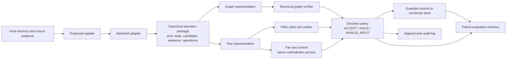

# 3.1 Thinking Framework

Chapters 1 and 2 established the problem this study addresses and positioned it against existing memory systems and transition-verification work. The open question they leave is narrow: whether the representation used to verify a proposed memory update matters at all, once the information available to the verifier is held constant. Graph structures in memory systems are motivated mainly by organisation and retrieval, and in the present setting the only visible graph-versus-text difference is confined to a single annotation-access asymmetry. This section therefore does not restate the background. It states the framework that operationalises the representation question: the hypothesis under test, the decomposition that makes it testable, the artefact that instantiates it, and the mapping to the research questions.

The framework starts from the possibility that relational structure can expose update failures that are not apparent from the candidate records alone, but it refuses to assume that it does. The central hypothesis is that it can, and the central methodological requirement is that this hypothesis can only be tested when both representations receive **the same underlying facts**. If a graph verifier consumes an annotation — for instance evidence that explicitly contradicts a retained claim — while a text verifier does not, then any resulting difference measures *information access*, not representation. The framework therefore separates two questions that are easily conflated: whether contradiction or provenance information matters at all, and whether encoding the same information as graph structure adds anything beyond a flat representation of the same facts. The first is tested by comparing a plain text verifier with a fair text control that reads the same contradiction annotations; the second is tested by comparing that fair control with the structural graph verifier. This decomposition is the conceptual contribution of the study, and it is what allows a negative result to be informative rather than merely disappointing.

MemBud operationalises this framework as a verification layer that sits between a host memory system and its persistent write. A proposed update, together with the relevant prior records, source evidence, and declared operations, is converted by a backend adapter into a canonical transition package. The package is represented twice — as a canonical graph and as a deterministic text/JSON serialisation — and the same three criteria of coverage, preservation, and faithfulness [@yang2026trustmem] are applied in each representation. A decision policy maps the check outcomes to a commit decision, and only an accepted candidate is written to the guarded store; every outcome is recorded in an append-only audit log. Figure 3.1 summarises the framework.

*Figure 3.1. Thinking framework. The same canonical transition feeds both representations. The fair text control is not a production verifier but a methodological instrument that isolates information access from representation.*

Three considerations shape the rest of the design. First, safety is treated as a **pre-commit** property: verification is performed on the proposed transition, a failed or uncertain check results in a hold, and a schema-invalid transition is rejected before verification and never reaches storage. This is a deliberately conservative policy, and its cost — blocking legitimate updates — is measured rather than assumed away. Second, the representation is the **object of study, not a premise**: the canonical package is the single source of truth, both representations are generated from it, and no verifier receives information the other cannot obtain from the same package. Third, the evaluation is **evidence-first**: cases are frozen and hash-pinned before runs, the development and held-out splits are fixed together, every numerator and denominator is reported, and the analysis is descriptive at the available sample size. The design therefore can produce three kinds of outcome — a positive representation effect, no detectable effect, or a cost without benefit — and all three are treated as valid results.

The framework maps onto the three research questions stated in Chapter 1. RQ1 (reliability) is operationalised as paired conditions over identical cases plus the information-matched control described above, so that the reliability effect and the representation question are answered separately. RQ2 (modularity) is operationalised at the level of the adapter contract, a reference backend, and a documented feasibility inspection of two third-party systems; evaluation across three external backends remains future work. RQ3 (trade-offs) is operationalised as acceptance, false-hold, token and latency instrumentation; downstream question answering was not evaluated and is not inferred from acceptance decisions.

The scope of the framework is deliberately bounded. MemBud is a verification layer, not a memory system, and it is evaluated as a controlled artefact on synthetic transition cases rather than on production traffic. Third-party backend integration and downstream question-answering utility are architectural ambitions that motivate the design but are not claimed as evaluated contributions in this study. Within that boundary, the framework makes a specific and testable proposition: that a fair comparison between graph and text verification, together with a transparent account of what each representation can see, yields more defensible knowledge about memory-transition safety than a comparison that confounds representation with information access. The remaining sections describe the data, the preprocessing, the models, and the evaluation procedure that instantiate this framework.
